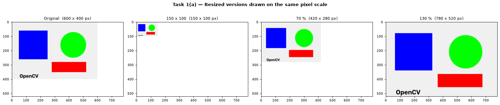
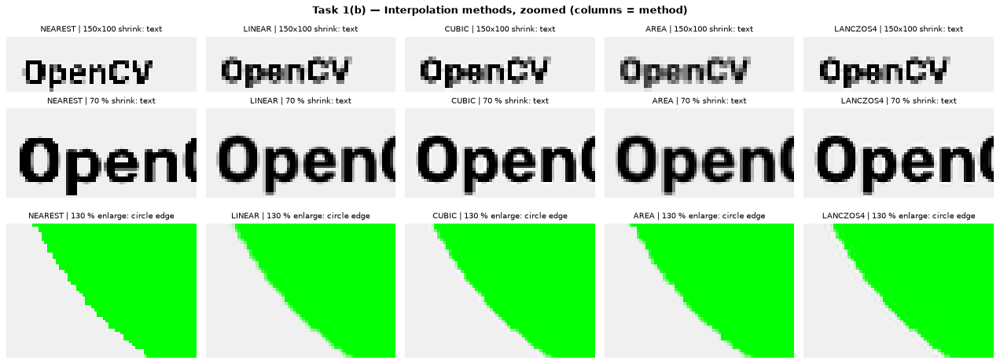
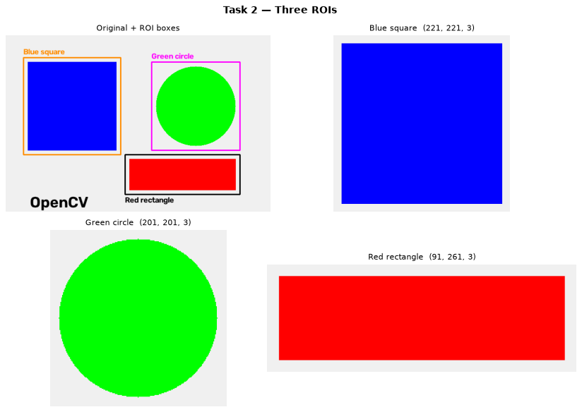
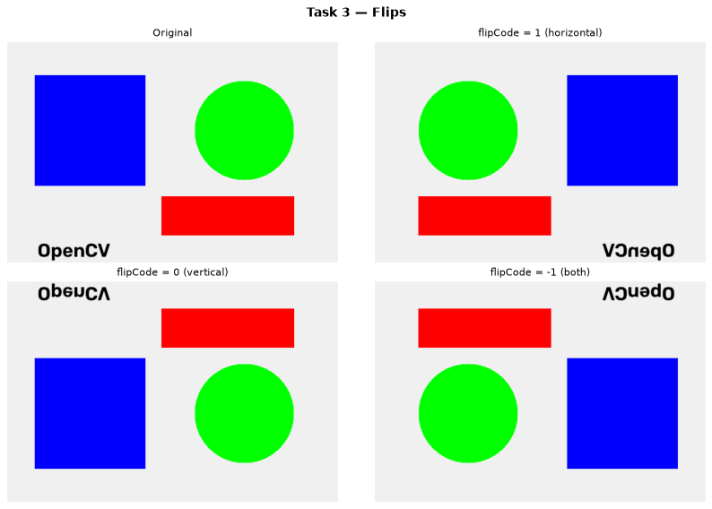
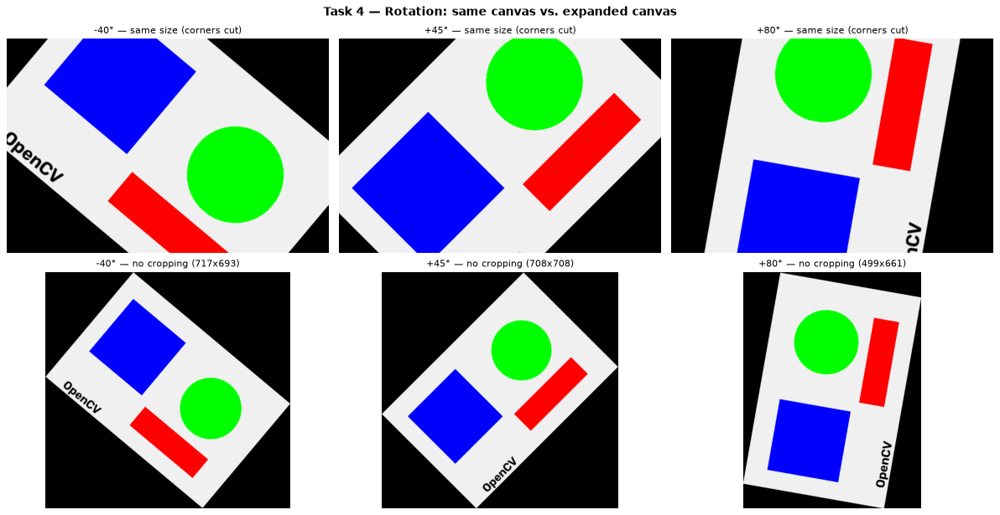
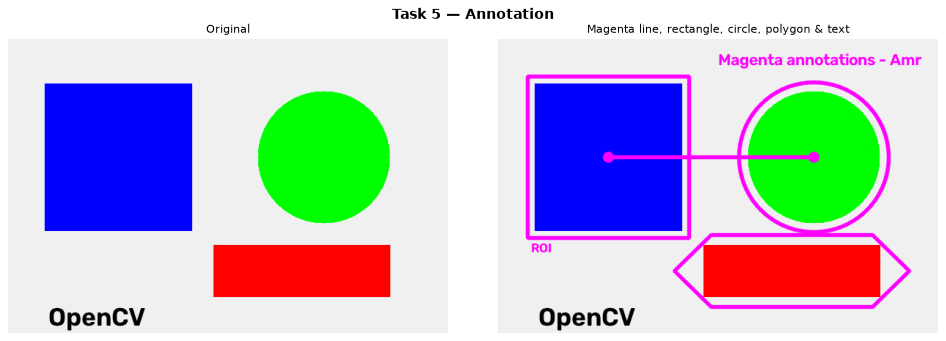
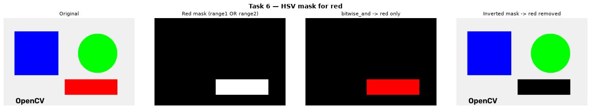
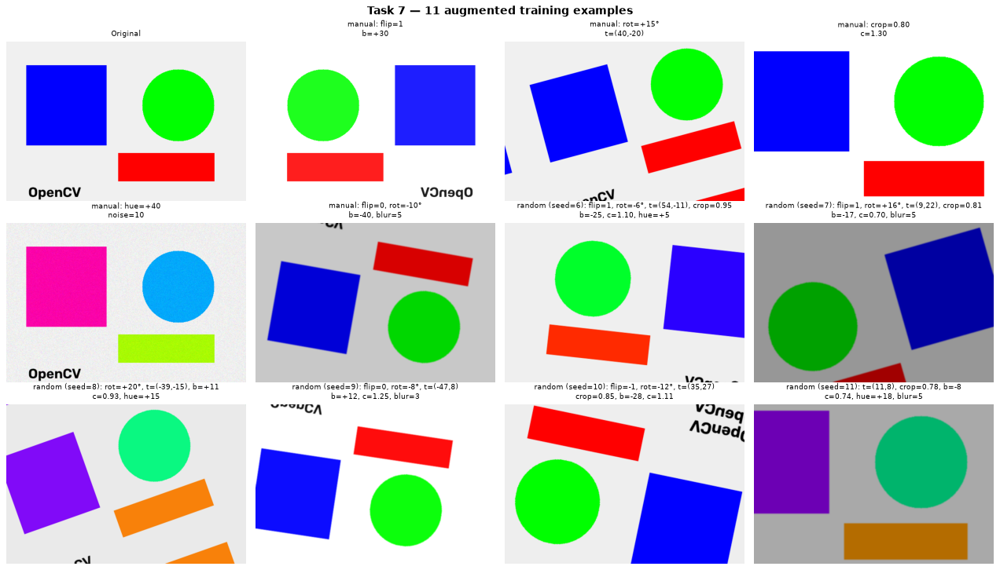
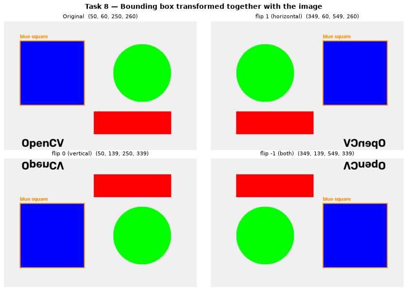
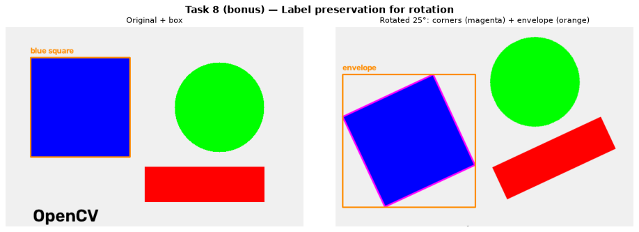

# Computer Vision — Section 2 Tasks (OpenCV)

[](https://colab.research.google.com/github/amr-elgharip2006/cv-section2-tasks/blob/main/CV_Section2_Solutions.ipynb)


**Course:** Computational Vision — Section 2 (م/ آية مطاوع)
**Topic:** Image manipulation, color spaces and augmentation
**Student:** Amr Ahmed Elgharip

> حل الـ 8 تاسكات بتوع Section 2 كاملة، والنتايج متسجلة جوه النوت بوك.

> ⚡ **Solutions only:** [`CV_Section2_Solutions.ipynb`](CV_Section2_Solutions.ipynb) — the Colab badge opens this one. The full section notebook with the solutions at the end is kept too.

The solutions are in [`CV_Section2_Tasks_Amr.ipynb`](CV_Section2_Tasks_Amr.ipynb), under **"Solutions — Amr"** after the *Practice Tasks* cell.
They use the notebook's synthetic teaching image `img`, so they run in Colab without uploading anything.
All outputs are saved, so you can read the notebook directly on GitHub.

---

## Tasks at a glance

| # | Task | What the solution does |
|---|---|---|
| 1 | **Resize** | 150×100, 70% and 130% versions, drawn at the same pixel scale. Compares NEAREST / LINEAR / CUBIC / AREA / LANCZOS4 on zoomed details, with timings and a conclusion: **AREA** for shrinking, **CUBIC / LANCZOS4** for enlarging, **NEAREST** for masks. |
| 2 | **Crop** | Three ROIs (square, circle, rectangle) using NumPy slicing, marked on the original image. Explains when a slice is a view and when it is a copy. |
| 3 | **Flip** | Horizontal, vertical and both. Checks that `flip(-1)` equals a 180° rotation. |
| 4 | **Rotate** | −40°, +45° and +80° using `getRotationMatrix2D` + `warpAffine`. Each angle is shown twice: on the same-size canvas (corners get cut) and on an **expanded canvas** with no cropping. |
| 5 | **Annotation** | Magenta line, rectangle, circle, polygon and text, all drawn with `LINE_AA`. |
| 6 | **HSV mask** | Isolates the red object. Red wraps around hue 0/180, so the mask joins two hue ranges with `bitwise_or`. The result is checked by pixel count. |
| 7 | **Augmentation** | `augment_image(image, ...)` applies flip, rotation, translation, crop, brightness / contrast, hue shift, noise and blur. It has a manual mode, a `random=True` mode and a `seed` for reproducible results. The grid shows **11 training examples**. |
| 8 | **Label preservation** | `flip_bbox()` updates the bounding box for all three flips. Each new box is checked against the box measured from the flipped pixels. Bonus: a rotated box built from its 4 corners and their min/max envelope. |

---

## Results

### Task 1 — Resize & interpolation



### Task 2 — Crop / ROI


### Task 3 — Flip


### Task 4 — Rotate (same canvas vs expanded canvas)


### Task 5 — Magenta annotation


### Task 6 — HSV mask


### Task 7 — `augment_image()` training examples


### Task 8 — Bounding box follows the image



---

## Notes

- **Bounding-box flip formula.** Box corners here are *pixel indices*, so a horizontal flip maps `x → W − 1 − x`.
  The section's formula `W − x` works for continuous coordinates, but on pixel indices it shifts the box by one column. The notebook explains this.
- **Brightness / contrast** use `np.clip` instead of `cv2.convertScaleAbs`, so negative values become 0 instead of being turned positive.
- Rotation and translation fill the empty borders by reflection (`BORDER_REFLECT_101`), as in the section. That is why mirrored pieces of the "OpenCV" text can appear near the edges.

## Run it

- **Colab:** click the badge above → *Runtime → Run all*.
  (The two upload cells from the section are optional; the solutions don't need them.)
- **Locally:**

  ```bash
  pip install opencv-python numpy matplotlib jupyter
  jupyter notebook CV_Section2_Tasks_Amr.ipynb
  ```

---

The section notebook *"Section 2 — Image Manipulation, Color Spaces & Augmentation"* is by the course TA. The task solutions are my own work.
